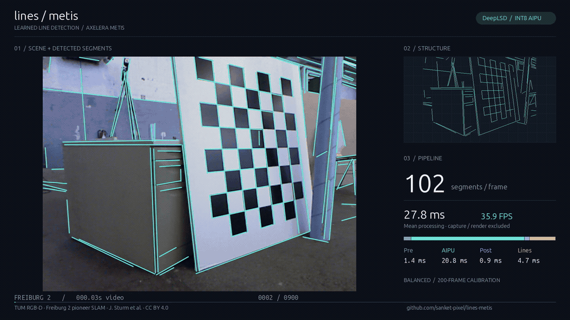

# lines-metis

**Learned line segment detection on Axelera Metis, with a C++ inference pipeline and a Python showcase renderer.**



A camera image contains useful structure: wall boundaries, door frames, pillars, table edges and floor markings. `lines-metis` turns that structure into 2D line segments, represented by their two endpoints in the original image.

The project ports the [DeepLSD](https://github.com/cvg/DeepLSD) neural network to INT8 inference on a Metis AIPU. Preprocessing, field decoding and a custom segment extractor run in C++; Python handles model preparation and the optional 1080p presentation. The demo uses **balanced** settings and a model calibrated with **200 Freiburg 2 frames**.

## Why lines matter in robotics

Point features can be sparse on plain walls, corridors and other surfaces with little texture. Lines provide complementary geometric constraints along visible boundaries. Downstream systems can use them for visual odometry and SLAM, camera localization against a map, or reconstructing indoor structure. DeepLSD demonstrates line features for localization and 3D reconstruction in [the CVPR 2023 paper](https://arxiv.org/abs/2212.07766); [LIMAP](https://github.com/cvg/limap) is an example of a downstream mapping and localization toolbox.

This repository provides the **line detection front end**. Its output is a list of `[x1, y1, x2, y2]` image coordinates, ready for a separate matching, mapping or pose-estimation stage. Frames are processed independently; tracking, depth estimation, SLAM and ROS integration are outside the current implementation.

## Pipeline and Metis backend

```text
Video frame (BGR)
    → Preprocessing       grayscale → INTER_AREA 320×240 → /255 → INT8 + physical padding
    → AipuInference       DeepLSD on one Metis core through AxRuntime
    → Postprocessing      crop → dequantize each head → distance + orientation fields
    → SegmentExtractor    region growing → weighted PCA → validation → joining → deduplication
    → Pipeline            map endpoints back to original-image pixels
```

`Pipeline` owns the modules and the AIPU context. `AipuContext` manages the runtime context; `AipuInference` owns the connected device, compiled model, instance and buffers. Tensor shapes, padding, scales, zero points and output identities are validated against model/runtime metadata. They are not YAML parameters.

The CNN produces normalized distance and orientation heads. Postprocessing decodes `distance = 5 × exp(-distance_normalized)` and `orientation = π × orientation_fraction`. Endpoints are mapped exactly once with the pixel-center convention `(coordinate + 0.5) × scale - 0.5`.

The custom C++ extractor reuses geometry, uses stable seed ordering and fits independent regions in parallel. It differs from upstream DeepLSD's guided LSD, including its refinement and statistical validation. This is a deployment demonstration, without a quantitative detection-accuracy claim. Weak edges can be missed, and segments can fragment or flicker. Inputs with other aspect ratios are resized to the fixed 4:3 network shape.

Only the CNN runs on the AIPU. Preprocessing, decoding and extraction run on the host CPU. The Python visualization is rendered offline from saved detections; its encoding cost is separate from inference performance.

## Setup

Validated locally on Ubuntu 24.04, GCC/C++17, Python 3.11, **Voyager compiler 1.7.0** and **AxRuntime 1.7.0**, with connected Metis hardware. SDK/runtime/driver versions must be compatible. See Axelera's [SDK installation guide](https://github.com/axelera-ai-hub/voyager-sdk/blob/latest/docs/user-guides/sdk-install.md) and release compatibility information when setting up your device. Newer SDK releases have not been validated by this project.

```bash
git clone https://github.com/sanket-pixel/lines-metis.git
cd lines-metis

sudo apt-get update
sudo apt-get install -y build-essential cmake pkg-config curl ffmpeg \
  libopencv-dev libyaml-cpp-dev nlohmann-json3-dev libssl-dev fonts-dejavu-core
```

Install [uv](https://docs.astral.sh/uv/getting-started/installation/) if it is not available, then prepare the project environment and model:

```bash
make setup
make data
make sample
make export
make compile SDK=/path/to/voyager-sdk
make fancy
```

Run these commands from the repository root. The SDK must already be installed with its compiler environment and runtime headers/libraries. `SDK` defaults to the sibling directory `../voyager-sdk`; `SDK_PYTHON` can select another installed compiler interpreter. `AXRUNTIME_ROOT` defaults to `/opt/axelera` and can point directly to a runtime installation.

### Weights, export and calibration

`make setup` creates `.venv`, installs the pinned Python dependencies and downloads the official [MegaDepth checkpoint](https://cvg-data.inf.ethz.ch/DeepLSD/deeplsd_md.tar). It verifies the upstream SHA-256 before extracting a tensor-only `weights/torch/deeplsd.pt`. Existing weights are retained. The model was pretrained by the DeepLSD authors; no training is performed here.

`make export` writes the static FP32 ONNX model and metadata under `weights/onnx/`, with ONNX graph validation. `make compile` uses the Voyager environment to quantize and compile it for **one Metis core**. Calibration selects 200 distinct, evenly spaced RGB frames from `freiburg2_pioneer_slam`, using the same grayscale/resize/normalization as inference.

```bash
make compile SDK=/path/to/voyager-sdk CALIB_IMAGES=200
# Optional recalibration; replaces weights/aipu/ after successful compilation:
make compile SDK=/path/to/voyager-sdk CALIB_IMAGES=400
```

Export and compilation are explicit preparation steps. Ordinary video/render commands reuse the installed model. Keep `weights/aipu/` and its matching sibling `weights/onnx/` together: the backend validates the compiled model's ONNX provenance. Existing compiled binaries are local artifacts and are not included in Git. A fresh clone needs export and compilation, or a complete matching model bundle copied into these directories.

### Dataset and sample

`make data` downloads the official [TUM RGB-D Freiburg 2 pioneer SLAM sequence](https://cvg.cit.tum.de/data/datasets/rgbd-dataset/download) (about 1.6 GB compressed) and retains its 2,921 RGB PNGs in `data/tum/freiburg2_pioneer_slam/`. The sequence was captured from a camera on a Pioneer robot. Depth and ground truth are not needed by this application. An already populated RGB directory is reused.

`make sample` creates the default `data/sample.mp4`: **900 consecutive RGB frames, 640×480, played at 30 FPS for 30 seconds**, encoded losslessly to preserve the input pixels. Playback follows frame order rather than the irregular original dataset timestamps. Recreating the sample replaces that file; `DURATION=20` can request a shorter excerpt.

If you downloaded the archive manually, copy the files inside its `rgb/` folder directly into `data/tum/freiburg2_pioneer_slam/`, then run `make sample`.

## Make commands

| Command | Result |
| --- | --- |
| `make build` | Release executable at `build/cpp/lines_metis` |
| `make video` | Simple line overlay at `results/balanced/video.mp4` |
| **`make fancy`** | C++ detections + Python 1080p showcase at **`results/balanced/showcase.mp4`** |
| `make render` | Re-render saved detections without loading or running the model |
| `make profile` | Mean preprocessing, inference, postprocessing, extraction and total timings |
| `make gif` | Six-second looping README preview at `assets/demo.gif` |
| `make help` | Short command reference |

Video, profile and fancy commands build automatically. Balanced is the default. Outputs are grouped by preset, and rerunning a command replaces its selected generated files.

```bash
make fancy PRESET=strict
make fancy PRESET=relaxed
make video VIDEO="/path/to/robot video.mp4"
make fancy VIDEO="/path/to/robot video.mp4" SHOWCASE=results/balanced/my_showcase.mp4
make profile CONFIG=configs/strict.yaml
```

The fancy path saves `detections.jsonl`, `showcase.mp4`, a poster `showcase.png` and measured averages in `showcase.json` under `results/<preset>/`. The local results also retain the three full-sequence comparisons as `<preset>/full.mp4`, with their original measurements in `full.json`; `balanced/full_detections.jsonl` preserves the complete optimized detection run for future rendering. JSONL contains the input/model/settings metadata, ordered frame endpoints and stage timings, followed by a completion record. These endpoints are in original-image coordinates; visualization does not transform them a second time. The renderer preserves the input aspect ratio.

The display shows the source scene, the exact detected segments, a geometry-only companion view, frame counts and measured stage means. **Processing FPS** is `1000 / mean Pipeline milliseconds`; it includes the first frame and endpoint mapping, and excludes model loading, decoding, JSON export, rendering and encoding. **Playback FPS** follows the input video. These numbers measure different things.

For visual iteration after one inference run:

```bash
make render
make gif

# A cached excerpt or a still, using only Python + FFmpeg:
.venv/bin/python python/visualize_results.py \
  --results results/balanced/detections.jsonl \
  --output results/balanced/excerpt.mp4 --start 120 --frames 300 --tum
```

The standard sample is credited automatically. `--tum` adds the Freiburg dataset attribution for other Freiburg exports; omit it for unrelated footage. `--video /new/source.mp4` relocates a cached source video, and `--image-root /new/rgb` supports older PNG-sequence exports. Use `--preview path.png --preview-frame 120` for a still, or `--overwrite` to replace chosen render outputs. `./setup.sh --viz-only` installs just NumPy, OpenCV and Pillow when only rendering cached results. Ubuntu fonts are used when available, with a DejaVu fallback.

`make gif` reads the selected `SHOWCASE`, taking seconds 0–6 at 10 FPS and 960 pixels wide. Run `make fancy` first. The full 30-second balanced MP4 is the LinkedIn upload asset; the GIF is the lightweight repository preview.

## Configuration

The model directory is configurable. YAML paths are resolved relative to their containing file. For example:

```yaml
inference:
  model_directory: ../weights/aipu

segment_extractor:
  presets_file: segment_presets.yaml
  strictness: balanced
  joining_enabled: true
  # Optional overrides, measured in 320×240 network pixels:
  # min_length: 10.0
  # max_join_gap: 8.0
```

Full preset thresholds live in [`configs/segment_presets.yaml`](configs/segment_presets.yaml). Unknown settings and invalid values are rejected.

| Preset | Minimum support | Maximum mean distance | Maximum join gap | Minimum length |
| --- | ---: | ---: | ---: | ---: |
| Strict | 0.8 | 0.8 | 4 | 10 |
| **Balanced** | **0.7** | **1.1** | **8** | **10** |
| Relaxed | 0.6 | 1.5 | 12 | 8 |

Strict is the original accepted baseline. Balanced recovers more structure and is the selected demo preset; relaxed accepts weaker support and larger gaps. These are visual tuning presets rather than benchmarked accuracy levels. Distances, gaps and lengths above are in network pixels.

`PRESET` chooses the standard YAML and results directory. If supplying a custom `CONFIG`, set `PRESET` too when you want a different output folder. The exported/rendered preset label always comes from the actual YAML.

## Performance

The 900-frame balanced showcase measured **27.8 ms/frame (35.9 processing FPS)** on an AMD Ryzen 7 3700X host with one Metis core and the 200-frame-calibrated model:

| Stage | Mean time |
| --- | ---: |
| Preprocessing | 1.4 ms |
| AIPU inference | 20.8 ms |
| Postprocessing | 0.9 ms |
| Segment extraction | 4.7 ms |
| Complete Pipeline | **27.8 ms** |

These are local Pipeline measurements, not camera-to-display throughput or an accuracy benchmark. Expect variation with the host, input and runtime; use `make profile` for your system. Every new showcase records its own timings in its JSON sidecar and displays those measurements.

## Code layout and C++ use

```text
cpp/app/main.cpp             video runner, detection export and profiling
cpp/include/                stage and Pipeline interfaces
cpp/src/                    stage implementations
  common/                   typed configuration and shared types
  inference/                AipuContext and AipuInference
configs/                    YAML presets and example configurations
python/                     model preparation, runtime reference and visualization
assets/demo.gif             tracked README preview
weights/                    local model artifacts and tracked provenance
results/{balanced,strict,relaxed}/  local generated outputs
```

```cpp
#include "pipeline.h"

const auto config = lines::LoadConfig("configs/balanced.yaml");
lines::Pipeline pipeline(config);
const auto segments = pipeline.Process(bgr_frame);  // std::vector<lines::Segment>
```

Keep one Pipeline instance across frames to reuse its model and buffers. The video app also supports direct use:

```bash
./build/cpp/lines_metis --video data/sample.mp4 --config configs/balanced.yaml \
  --detections results/balanced/detections.jsonl --profile
```

Optional `--output path.mp4` saves the simple overlay. Press Ctrl+C to stop. Interrupted detection exports remain `.jsonl.partial` files; only complete exports replace the final JSONL. Use `JOBS=4`, `BUILD_DIR=build`, `PYTHON=/path/to/python` or `AXRUNTIME_ROOT=/path/to/runtime` to override the corresponding Make defaults.

## Attribution and license

DeepLSD: Rémi Pautrat, Dániel Baráth, Viktor Larsson, Martin R. Oswald and Marc Pollefeys, *DeepLSD: Line Segment Detection and Refinement with Deep Image Gradients*, CVPR 2023. The upstream model and pretrained weights are **MIT** licensed.

Demo footage: Jürgen Sturm et al., *A Benchmark for the Evaluation of RGB-D SLAM Systems*, IROS 2012, [TUM RGB-D](https://cvg.cit.tum.de/data/datasets/rgbd-dataset). Dataset images are **CC BY 4.0** unless otherwise stated by the authors. The README GIF and showcase add detected-line and performance overlays to this footage. Keep this credit when sharing them.

The C++ pipeline is **AGPL-3.0-or-later**. SDK/runtime libraries retain Axelera's licenses and are not redistributed. See [LICENSE](LICENSE) and [THIRD_PARTY_NOTICES.md](THIRD_PARTY_NOTICES.md). Git contains code, configuration, provenance and the README GIF; datasets, model binaries, builds and generated result videos stay local.
